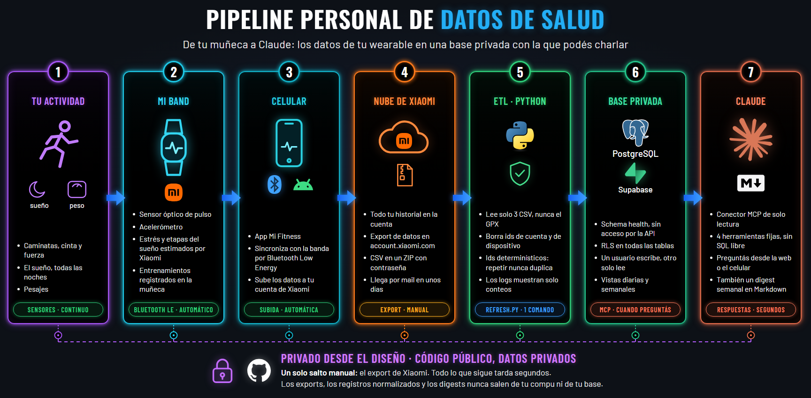
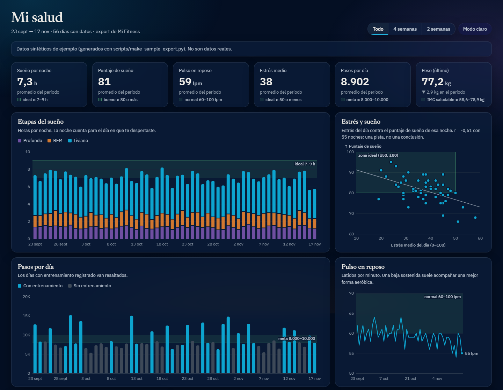

# Pipeline personal de datos de salud
<p>
  <a href="README.md"></a>
  <a href="README.es.md"></a>
</p>

Convertí tu historial de **Xiaomi Mi Band / Mi Fitness** en datos a los que realmente les podés preguntar cosas. Incluye un ETL privado e idempotente, un schema de Postgres blindado, un digest semanal en Markdown para cualquier LLM y un **conector MCP** de solo lectura. Con el conector, Claude te responde desde la web o el celular preguntas como *"¿dormí peor las noches después de entrenar en cinta?"*.

El código es público y los datos son privados: cada registro real queda en tu compu o en tu propio proyecto de Supabase.

## De tu muñeca a Claude

<p align="center">
  
</p>

<details>
<summary><b>Salto por salto</b></summary>

| Salto | Cómo | ¿Automático? | Demora |
|---|---|---|---|
| Tu actividad → Mi Band | Sensor óptico de pulso y acelerómetro. El estrés y las etapas del sueño los estiman los algoritmos de Xiaomi. | sí | continuo |
| Mi Band → celular | Bluetooth Low Energy, a través de la app Mi Fitness | sí, cuando la app sincroniza | minutos |
| Celular → nube de Xiaomi | Mi Fitness sincroniza con tu cuenta de Xiaomi | sí | minutos |
| Nube de Xiaomi → este repo | Export de datos de la cuenta: archivos CSV en un ZIP con contraseña, que llega por mail | **no, manual** | días (Xiaomi habla de hasta unos 15 días hábiles) |
| Export → Supabase | `scripts/refresh.py`: normaliza, borra identificadores y hace el upsert | un comando | segundos |
| Supabase → vos | Digest semanal en Markdown, o Claude consultando los datos en vivo con el conector MCP mientras charlás | cuando lo pedís | segundos |

</details>

El único salto lento y manual es el export, y es a propósito: **este camino por export funciona con cualquier celular, incluso con Android 13 o anterior.** Desde Android 14, Health Connect viene integrado en el sistema, así que el export se podría reemplazar por una sincronización automática en segundo plano, sin pasos por lotes. Es la próxima etapa planeada, todavía no está construida (ver [Hoja de ruta](#hoja-de-ruta)).

Adentro de este repo:

```text
Export de la cuenta de Mi Fitness (CSV, se pide en account.xiaomi.com)
        │  scripts/import_mifitness.py   normaliza · borra identificadores · idempotente
        ▼
data/processed/mi_fitness/*.jsonl        privado, Git lo ignora
        ├──► scripts/weekly_digest.py → data/reports/weekly/<semana ISO>.md   para pegar en cualquier LLM
        │
        └──► scripts/load_supabase.py    upsert por id determinístico, usuario con permisos mínimos
                     ▼
             Supabase Postgres · schema `health`   sin acceso por la API · RLS · sin acceso anónimo
             vistas health.daily_metrics / health.weekly_metrics
                     ▼
             Edge Function `health-mcp`  servidor MCP de solo lectura ──► conector personalizado de Claude (web y celular)
```

## Dashboard

<p align="center">
  
</p>

`python scripts/dashboard.py` arma un único archivo HTML, sin dependencias, que se abre en cualquier navegador, incluso en el celular. Muestra indicadores contra el período anterior, las etapas del sueño por noche, el estrés del día contra el sueño de esa noche, el pulso en reposo, los pasos con los días de entrenamiento resaltados, el peso y tablas semana a semana y día por día. Tiene tooltips al pasar el mouse o con el teclado, modo claro y oscuro, y una paleta validada para personas con daltonismo. Cada gráfico e indicador muestra un **rango ideal aproximado** con su fuente: sueño de 7 a 9 h, 8.000 a 10.000 pasos, pulso en reposo de 60 a 100 lpm, estrés de hasta 50 en la escala de Xiaomi, puntaje de sueño de 80 o más, y una franja de peso saludable si cargás `HEALTH_HEIGHT_CM`. Los rangos viven en [`dashboard/references.json`](dashboard/references.json), así podés adaptarlos a tu edad o a lo que te indique tu médico. Tiene tarjetas de estilo vidrio esmerilado y se adapta desde una pantalla ancha hasta el celular. La imagen de arriba usa datos sintéticos; tu dashboard queda en `data/reports/` (Git lo ignora).

**Hacelo tuyo:** el aspecto vive en [`dashboard/theme.json`](dashboard/theme.json): colores para modo oscuro y claro, tipografías y títulos. Editalo, o pasá tu propio archivo con `--theme-file`, y los gráficos lo siguen; el diseño y los gráficos están en [`dashboard/template.html`](dashboard/template.html). El tema por defecto usa los colores de la marca GlobalAIze, con la paleta de los gráficos validada para personas con daltonismo.

## Usalo con tus propios datos

**→ Guía completa paso a paso: [docs/setup-guide.es.md](docs/setup-guide.es.md)**

| Etapa | Qué obtenés | Tiempo |
|---|---|---|
| 1. Pedirle tu export a Xiaomi | Tu historial en archivos CSV | unos minutos, y después esperar el mail |
| 2–3. Clonar, configurar y normalizar | JSONL limpio, sin identificadores | ~10 min |
| 4. Digest semanal y dashboard | Un resumen en Markdown para cualquier asistente, y un dashboard en HTML | 1 comando cada uno |
| 5. Supabase *(opcional)* | Tus datos en un schema privado de Postgres | ~15 min, plan gratis |
| 6. Conector de Claude *(opcional)* | Charlar con tus datos desde la web o el celular | ~10 min |

El camino más corto (etapas 1 a 4) solo necesita Python 3.10 o superior, sin dependencias:

```bash
git clone https://github.com/mauroemartinez/personal-health-pipeline.git
cd personal-health-pipeline
cp .env.example .env                  # Windows: copy .env.example .env  → completá HEALTH_UTC_OFFSET
# descomprimí tu export de Mi Fitness en data/private/mi_fitness_export/
python scripts/import_mifitness.py    # normaliza (se puede repetir sin problema)
python scripts/weekly_digest.py       # → data/reports/weekly/<semana ISO>.md
python scripts/dashboard.py           # → data/reports/dashboard.html
```

**¿No tenés una Mi Band? Probalo con datos sintéticos:** `python scripts/refresh.py --sample` genera un export falso pero realista (8 semanas, con patrones para que un LLM los encuentre), lo normaliza y escribe un digest en `data/reports/sample/`. Los datos sintéticos quedan marcados y en carpetas separadas: nunca se pueden mezclar con datos reales ni llegar a tu base por accidente.

La guía también explica cómo actualizar con exports nuevos, los problemas comunes, los costos y cómo desinstalar.

## Cómo funciona

Cómo y por qué se diseñó cada pieza, cómo se mapeó el export sin mostrar nunca un valor de salud y qué problemas se resolvieron en el camino: **[docs/design-notes.es.md](docs/design-notes.es.md)**.

Lo más importante:

- **Idempotente de punta a punta:** los ids salen de claves naturales. Correr el importer de nuevo da archivos idénticos byte a byte, y volver a cargar no escribe ninguna fila si nada cambió.
- **Privacidad desde el diseño:** los identificadores se borran en todos los niveles del JSON; los GPX, perfiles y archivos de dispositivos nunca se leen; los scripts solo muestran conteos, y los errores de base se informan solo con su código SQLSTATE.
- **Permisos mínimos:** un usuario que solo escribe para la carga, otro que solo lee para el conector, ninguna clave de superusuario ni service-role en el pipeline, y un control que impide escribir en el proyecto equivocado.
- **Listo para LLMs:** un digest para pegar en cualquier lado, o un servidor MCP con cuatro herramientas fijas de solo lectura (sin SQL libre) detrás de una ruta secreta, en transacciones de solo lectura con límite de tiempo.

## Estructura del repo

```text
scripts/
  inspect_export.py          estructura del export (encabezados, conteos) sin valores
  import_mifitness.py        export → data/processed/mi_fitness/*.jsonl
  weekly_digest.py           JSONL → data/reports/weekly/<semana>.md
  dashboard.py               JSONL + dashboard/ → data/reports/dashboard.html (un solo archivo)
  load_supabase.py           JSONL → schema `health` de Supabase (valida, o --apply)
  deploy_connector.py        publica el conector MCP con la Management API de Supabase
  refresh.py                 todo el pipeline con un solo comando (o --sample con datos sintéticos)
  make_sample_export.py      export sintético de Mi Fitness para probarlo sin una Mi Band
dashboard/
  theme.json                 colores (oscuro / claro), tipografías y títulos: editalo para cambiar la marca
  references.json            rangos ideales aproximados que se dibujan en los gráficos, con sus fuentes
  template.html              diseño y gráficos (SVG puro, sin librerías)
supabase/
  migrations/0001_health_schema.sql   tablas, vistas, RLS, usuario de carga
  migrations/0002_health_reader.sql   usuario de solo lectura para el conector
  functions/health-mcp/index.ts       servidor MCP de solo lectura (Edge Function)
docs/
  setup-guide(.es).md        paso a paso con tus propios datos
  design-notes(.es).md       decisiones, mapeo de datos, lecciones aprendidas
assets/                      imagen de arquitectura y capturas del dashboard (EN / ES, datos sintéticos)
data/                        (Git lo ignora) exports privados, datos procesados, reportes
```

## Modelo de datos

| Tabla | Granularidad | Contenido |
|---|---|---|
| `health.observations` | métrica × momento | pulso, estrés, pasos, calorías, minutos de intensidad, intervalos de pie, sesiones de sueño, pulso en reposo, peso |
| `health.daily_summaries` | métrica × fecha local | reportes diarios de Mi Fitness (zonas de pulso, distribución del estrés, etapas y puntaje de sueño, pasos…) |
| `health.activities` | deporte × hora de inicio | caminatas, running indoor, fuerza; duración, distancia, pulso, carga; `incline_pct` y `notes` para carga manual |
| `health.import_runs` | corrida de carga | conteos y filas descartadas en cada carga |

Las horas se guardan en UTC. `local_date` usa la zona horaria de cada registro cuando Mi Fitness la informa y, si no, `HEALTH_UTC_OFFSET`. Una noche de sueño se asigna al día en que te despertás.

## Límite de privacidad

- Los exports reales, los registros normalizados, los digests, la URL del conector y las credenciales viven en rutas que Git ignora: `data/private/`, `data/processed/`, `data/reports/`, `.env`.
- El schema `health` no está expuesto en la Data API, y `anon` / `authenticated` no tienen ningún permiso.
- La URL del conector funciona como una contraseña: no la compartas.

## Hoja de ruta

- **Hoy:** exports manuales periódicos → ETL → Supabase → digest semanal y conector de Claude.
- **Próximo, para Android 14 en adelante:** sincronización automática con Health Connect en lugar de exports por lotes, para que el conector responda siempre con datos casi en tiempo real. El camino por export queda para Android 13 o anterior.
- **Ideas:** OAuth en lugar de la ruta secreta para el conector y una herramienta de escritura para cargar datos manuales (por ejemplo, la inclinación de la cinta).

## Licencia

[MIT](LICENSE)
