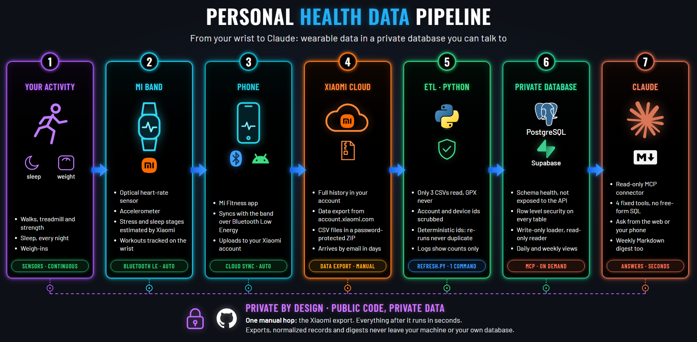

# Personal Health Data Pipeline
<p>
  <a href="README.md"></a>
  <a href="README.es.md"></a>
</p>

Turn your **Xiaomi Mi Band / Mi Fitness** history into data you can actually ask questions about: a private, idempotent ETL, a locked-down Postgres schema, weekly Markdown digests for any LLM, and a read-only **MCP connector** so Claude can answer questions like *"did I sleep worse on nights after treadmill workouts?"* from the web or your phone.

Public code, private data: every real record stays on your machine or in your own Supabase project.

## From your wrist to Claude

<p align="center">
  
</p>

<details>
<summary><b>Hop by hop</b></summary>

| Hop | How | Automatic? | Latency |
|---|---|---|---|
| Your activity → Mi Band | Optical heart-rate sensor and accelerometer. Stress and sleep stages are estimated by Xiaomi's algorithms. | yes | continuous |
| Mi Band → phone | Bluetooth Low Energy, through the Mi Fitness app | yes, when the app syncs | minutes |
| Phone → Xiaomi cloud | Mi Fitness syncs to your Xiaomi account | yes | minutes |
| Xiaomi cloud → this repo | Account data export: CSV files in a password-protected ZIP, delivered by email | **no, manual** | days (Xiaomi quotes up to ~15 business days) |
| Export → Supabase | `scripts/refresh.py`: normalize, scrub identifiers, upsert | one command | seconds |
| Supabase → you | Weekly Markdown digest, or Claude querying the data live through the MCP connector while you chat | on demand | seconds |

</details>

The only slow, manual hop is the export, and that is on purpose: **this export-based path works with any phone, including Android 13 and lower.** On Android 14 and later, Health Connect is built into the system, so the export could be replaced by automatic background sync, with no batch step. That is the next planned stage, not built yet (see [Roadmap](#roadmap)).

Inside this repo:

```text
Mi Fitness account export (CSV, requested at account.xiaomi.com)
        │  scripts/import_mifitness.py   normalize · scrub identifiers · idempotent
        ▼
data/processed/mi_fitness/*.jsonl        private, ignored by Git
        ├──► scripts/weekly_digest.py → data/reports/weekly/<ISO week>.md   paste into any LLM
        │
        └──► scripts/load_supabase.py    upsert by deterministic id, least-privilege role
                     ▼
             Supabase Postgres · schema `health`   not exposed to the API · RLS · no anon access
             views health.daily_metrics / health.weekly_metrics
                     ▼
             Edge Function `health-mcp`  read-only MCP server ──► Claude custom connector (web & mobile)
```

## Use it with your own data

**→ Full step-by-step guide: [docs/setup-guide.md](docs/setup-guide.md)**

| Stage | You get | Time |
|---|---|---|
| 1. Request your export from Xiaomi | Your history as CSV files | a few minutes, then wait for the email |
| 2–3. Clone, configure, normalize | Clean JSONL, no identifiers | ~10 min |
| 4. Weekly digest | A Markdown summary for any chat assistant | 1 command |
| 5. Supabase *(optional)* | Your data in a private Postgres schema | ~15 min, free plan |
| 6. Claude connector *(optional)* | Chat with your data from web or phone | ~10 min |

The shortest path (stages 1–4) needs only Python 3.10+, with no dependencies:

```bash
git clone https://github.com/mauroemartinez/personal-health-pipeline.git
cd personal-health-pipeline
cp .env.example .env                  # Windows: copy .env.example .env  → set HEALTH_UTC_OFFSET
# unzip your Mi Fitness export into data/private/mi_fitness_export/
python scripts/import_mifitness.py    # normalize (safe to re-run)
python scripts/weekly_digest.py       # → data/reports/weekly/<ISO week>.md
```

**No Mi Band? Try it on synthetic data:** `python scripts/refresh.py --sample` generates a realistic fake export (8 weeks, with patterns for an LLM to find), normalizes it and writes a digest under `data/reports/sample/`. Synthetic data is marked and kept in separate folders: it can never mix with real data or reach your database by accident.

The guide also covers updating with new exports, troubleshooting, costs and how to uninstall.

## How it works

How each piece was designed and why, how the export was mapped without ever printing a health value, and the problems solved along the way: **[docs/design-notes.md](docs/design-notes.md)**.

Highlights:

- **Idempotent end to end:** deterministic ids from natural keys; re-running the importer gives byte-identical files; re-loading writes zero rows if nothing changed.
- **Privacy by construction:** identifiers scrubbed recursively; GPX, profiles and device files never read; scripts print counts only; database errors reported by SQLSTATE only.
- **Least privilege:** a write-only loader role, a read-only connector role, no superuser or service-role keys in the pipeline, and a guard against writing to the wrong project.
- **LLM-ready:** a digest you can paste anywhere, or an MCP server with four fixed read-only tools (no free-form SQL) behind a secret path, in read-only transactions with a statement timeout.

## Repository layout

```text
scripts/
  inspect_export.py          structure of the export (headers, counts) without values
  import_mifitness.py        export → data/processed/mi_fitness/*.jsonl
  weekly_digest.py           JSONL → data/reports/weekly/<week>.md
  load_supabase.py           JSONL → Supabase schema `health` (validate, or --apply)
  deploy_connector.py        deploys the MCP connector via the Supabase Management API
  refresh.py                 whole pipeline in one command (or --sample for synthetic data)
  make_sample_export.py      synthetic Mi Fitness export for trying it without a Mi Band
supabase/
  migrations/0001_health_schema.sql   tables, views, RLS, loader role
  migrations/0002_health_reader.sql   read-only role for the connector
  functions/health-mcp/index.ts       read-only MCP server (Edge Function)
docs/
  setup-guide(.es).md        step by step with your own data (English / Spanish)
  design-notes(.es).md       decisions, data mapping, lessons learned (English / Spanish)
assets/                      architecture image (EN / ES) and its generator
data/                        (ignored by Git) private exports, processed data, reports
```

## Data model

| Table | Grain | Content |
|---|---|---|
| `health.observations` | metric × timestamp | heart rate, stress, steps, calories, intensity minutes, stand intervals, sleep sessions, resting HR, weight |
| `health.daily_summaries` | metric × local date | Mi Fitness daily reports (HR zones, stress distribution, sleep stages and score, steps…) |
| `health.activities` | sport × start time | walks, indoor running, strength; duration, distance, HR, training load; manual `incline_pct` and `notes` |
| `health.import_runs` | load run | counts and skipped rows per load |

Timestamps are stored in UTC. `local_date` uses each record's own timezone when Mi Fitness provides it, otherwise `HEALTH_UTC_OFFSET`. A night of sleep is assigned to the day you wake up.

## Privacy boundary

- Real exports, normalized records, digests, the connector URL and credentials live under ignored paths: `data/private/`, `data/processed/`, `data/reports/`, `.env`.
- The `health` schema is not exposed through the Data API, and `anon` / `authenticated` have no privileges.
- The connector URL works like a password; keep it private.

## Roadmap

- **Today:** periodic manual exports → ETL → Supabase → weekly digest and Claude connector.
- **Next, for Android 14 and later:** automatic sync through Health Connect instead of batch exports, so the connector always answers with near-real-time data. The export path stays for Android 13 and lower.
- **Ideas:** OAuth instead of a path token for the connector, and a write tool for manual enrichment (e.g. treadmill incline).

## License

[MIT](LICENSE)
